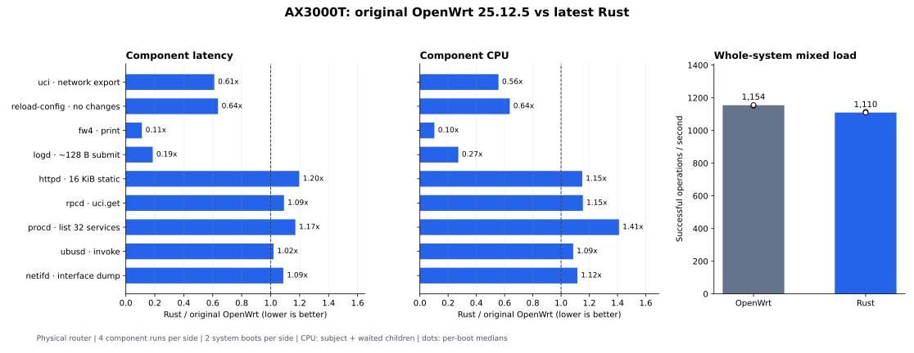

# R84：最新 Rust 与原版 OpenWrt 的实机对照

2026-09-10。R81 修复已推送至 GitHub，最新版九个组件已部署到 AX3000T，完成原版与 Rust 的单组件和整体替换对照。最终设备运行最新版 Rust，配置、双栈联网、双频 AP、管理页面和看门狗检查通过。

在固定四客户端混合负载下，原版 **1,154 次/秒**，Rust **1,110 次/秒**（-3.9%）；控制面 CPU 从每次 **782.6 µs** 变为 **879.9 µs**（+12.4%）。具体命令和服务存在明显差异，单项结果见下表。

## 比较对象与控制条件

- 同一 Xiaomi AX3000T RD03、两核 Cortex-A53、OpenWrt 25.12.5 `r33051-f5dae5ece4`、Linux 6.12.94；可见 RAM 239024 KiB。
- 原版侧运行官方镜像 `/rom` 中的九个原件，Rust 侧运行 R83 最终修复后的发布文件。逐次检查实际 `/proc/<pid>/exe` 与命令入口 SHA-256。
- 四个有效冷启动窗口依次为 Rust、原版、原版、Rust；每窗五轮，共 **2,002,600 次正式整机操作**。配置、执行面二进制、防火墙规则（消除计数器变化后）一致，每侧服务19项、实例15项。
- 主负载使用同一原生客户端在路由器上运行：HTTP经过回环接口，ubus经过本机UNIX socket。整体静态HTTP使用相同的44,042字节CSS文件，单组件静态HTTP使用16KiB固定文件。LAN HTTPS由有线连接的Mac发起，单独统计。
- 九个组件每侧各四次，共72次隔离运行；顺序 C/Rust/Rust/C/Rust/C/C/Rust。其余依赖固定为原版镜像。单组件 procd 使用监督模式，netifd 操作独立网络空间内的合成桥和静态接口；真实 PID1、网络和无线集成由整机窗口覆盖。
- 内核、驱动、DNS/DHCP、无线认证和数据转发执行面保持原版。本报告衡量控制面资源和管理请求，不提供未测量的转发 Mbps 结论。

## 单组件结果

代表性负载；延迟为四次运行平均延迟的中位数，单位 µs。两个倍率均为 Rust/原版，低于1代表该项开销较低。CPU 包含组件及其等待回收的子进程，常驻依赖和压测客户端另行统计。这些是实际发货实现的比较，包含所用库、算法和实现策略的差异。

| 组件 | 负载 | 原版平均 µs | Rust平均 µs | 延迟倍率 | CPU倍率 |
|---|---|---:|---:|---:|---:|
| uci | `export_network` | 2,092.10 | 1,278.25 | 0.61× | 0.56× |
| reload-config | `unchanged_config` | 40,001.34 | 25,455.57 | 0.64× | 0.64× |
| fw4 | `print` | 99,494.07 | 11,016.03 | 0.11× | 0.10× |
| logd | `syslog_128` | 28.22 | 5.24 | 0.19× | 0.27× |
| httpd | `static_16k` | 362.32 | 433.77 | 1.20× | 1.15× |
| rpcd | `uci_get_network` | 374.02 | 408.39 | 1.09× | 1.15× |
| procd | `service_list_32` | 215.40 | 252.12 | 1.17× | 1.41× |
| ubusd | `invoke` | 94.14 | 95.99 | 1.02× | 1.09× |
| netifd | `interface_dump` | 216.17 | 235.01 | 1.09× | 1.12× |

全部24种负载的平均/p95、CPU和常驻内存见 [单组件完整结果](R84_parts/component_results.md)。原始纳秒样本保存在私有目录；[results.json](R84_parts/results.json) 保留逐次派生统计、p50/p95/p99和运行间范围。

不能用每个组件的一项负载代表它的所有行为。例如，httpd的16KiB明文静态请求延迟增加 **19.7%**，而CGI和JSON-RPC分别减少 **20.2%**、**6.3%**。netifd的空无线状态查询也不代表真实无线重配性能。

`syslog_128` 测量约128字节日志数据报的发送耗时，包含队列背压；CPU和总吞吐区间还等待最终消息被logd消费。这不是逐条落盘延迟。常驻服务使用持久ubus连接，避免每次启动CLI的开销掩盖组件差异。

## 整体替换结果

同一启动窗口中的真实管理请求；延迟为每侧十轮统计值的中位数，单位 ms。

| 负载 | 原版平均 ms | Rust平均 ms | 延迟变化 |
|---|---:|---:|---:|
| `network` | 0.780 | 0.708 | -9.2% |
| `rpcd` | 0.451 | 0.557 | +23.4% |
| `procd` | 0.466 | 0.547 | +17.4% |
| `log` | 0.959 | 0.628 | -34.5% |
| `uci` | 2.298 | 1.456 | -36.6% |
| `fw4` | 202.852 | 16.591 | -91.8% |
| `http-static` | 0.663 | 0.672 | +1.4% |
| `http-jsonrpc` | 1.554 | 1.628 | +4.7% |

混合负载的每轮40,000次请求由服务管理、网络状态、UCI RPC和HTTP JSON-RPC四个客户端并行发起。其CPU采用单个共同外层区间，未累加重叠的逐客户端计数。吞吐包含客户端校验与连接/进程启动开销；单请求延迟在校验前结束。各启动窗口、空闲CPU和CPU客户端成本见 [整体完整结果](R84_parts/system_results.md) 及 results.json。

单组件测试一次只更换一个实现，整机测试同时更换全部九个组件，并使用真实设备配置；不能把各单体倍率相加来预测整体结果。

若按本次固定的整套负载计入每窗500,650次操作，控制面累计CPU为原版 **387.65s**、Rust **385.48s**（-0.56%）。这组权重中包含150次fw4规则生成，其节省抵消了部分RPC开销；更改负载比例会改变总量，不能以它替代上面的混合负载结果。此总量不含TLS和空闲采样。

每侧只有两次独立冷启动，同一启动内的五轮用于观察重复性。路由器仍承载背景网络活动，空闲整机CPU随窗口变化；因此报告分别列出进程CPU、整机CPU、启动间范围，不把小幅变化外推为所有场景的性能提升或下降。

日志读取使用各系统真实启动日志，正文不保证等长；固定消息条件下的 logd 结果以单组件对照为准。CLI写入测试使用独立tmpfs配置，不代表闪存写入延迟。

## 内存和存储

下面是预热后、主负载前120秒采样的中位数，再合并两次启动。单位 MiB。

| 指标 | 原版 | Rust | Rust−原版 |
|---|---:|---:|---:|
| 六常驻进程 RSS 合计（共享页重复计数） | 9.18 | 4.61 | -4.57 |
| 六常驻进程匿名 RSS 合计 | 2.21 | 1.16 | -1.04 |
| 整机 MemAvailable（受缓存状态影响） | 132.69 | 123.93 | -8.76 |
| 整机匿名页 AnonPages | 4.96 | 4.16 | -0.80 |
| 整机文件映射页 Mapped | 5.44 | 7.85 | +2.41 |
| 整机文件缓存 Cached | 21.41 | 34.95 | +13.54 |

本镜像没有 smaps/smaps_rollup，不能测量 PSS/USS。RSS合计会重复计入共享库；完整性检查还会读取整个可执行文件及Rust参照副本，形成不同的文件缓存状态。因此不能把RSS下降等同于整机独占物理内存节省，也不能把MemAvailable差值直接当作独占RAM净增加。全机匿名页、文件映射页和缓存分别列出；负载后的MemAvailable还包含tmpfs原始样本文件影响。

九个Rust可执行文件共 **7,594,634 bytes（7.24 MiB）**。原版九个入口文件为520,451 bytes（0.50 MiB），加其ELF依赖闭包为1,702,731 bytes（1.62 MiB）。另行清点shell、ucode、插件、TLS等所列运行支持文件，去重后共3,730,552 bytes（3.56 MiB）；这不是最小独占依赖集合。共享库和执行面仍被其他程序使用，原件也保留用于恢复。完整文件清单见 [storage_inventory.json](R84_parts/storage_inventory.json)；这些数值不等于可删除空间或压缩固件体积。

## LAN HTTPS

每组1,000次成功请求，单客户端和四客户端，分别测持续连接和新建连接。现有防火墙对输入SYN限制25次/s（突发50），新建连接双方统一每秒20次；这类吞吐受主动限速约束，比较延迟和CPU。

双方均使用TLS1.2。默认协商分别为原版ChaCha20、Rust AES256-GCM；另在第二次原版/Rust窗口的主要采样结束后，补测双方固定AES256-GCM。该受控组每侧一个启动样本。请求延迟不包括预热和主动等待；TLS服务端CPU区间包括已计数的预热和SSH采样开销。结果及实际套件见 [HTTPS完整结果](R84_parts/tls_results.md)。

在相同AES256-GCM套件下，单客户端新建连接的平均延迟为原版 **20.89ms**、Rust **6.11ms**；HTTP服务端CPU分别为 **16.66ms/次** 和 **2.33ms/次**。此组双方会话恢复次数均为0，全部执行完整握手。

## 部署、验证与复现

R81修复提交 `9183a5d`；发布版本递增 `9f66043`；发布清单修正 `b8b0dc3`。Canonical release-image [34477008696](https://github.com/WenliangCao/owrt-control-plane-rs/actions/runs/34477008696) 与前次 [34475612300](https://github.com/WenliangCao/owrt-control-plane-rs/actions/runs/34475612300) 的六个发货二进制及七个APK逐字节一致。procd、ubusd、netifd沿用R83已验证的精确直接部署文件。版本、哈希、来源及最终验证状态见 [preparation.json](R84_parts/preparation.json)。

用户确认恢复条件后核实lan4有线连接、离线备份与恢复镜像；以APK无脚本安装和受控冷启动完成部署。未刷写固件、内核或bootloader。未确认的Rust启动有整套900秒原版回退；本次所有有效启动均经过连续健康观察，未触发恢复。恢复入口见 [救援手册](../../docs/RUNBOOK_AX3000T_RECOVERY.md)。

正式计时只纳入成功且校验通过的操作。数据归档后逐文件校验，再删除其精确临时目录；固件、APK、配置、原始设备日志和样本保留在Git外。工具与方法见 [benchmark README](../../tools/benchmark/README.md)。

测量准备中发现并修正了三个干扰：新建连接超过现有SYN限速、临时RPC账号缺少UCI读取权限，以及回环大MSS下原版uhttpd与延迟ACK产生约50ms等待。最终本机HTTP客户端使用完整请求缓冲区，并在每次读取后刷新TCP_QUICKACK；双方完全相同，不更改全局TCP设置。实机诊断中，修正后原版1,000次静态请求平均0.698ms、1,000次RPC平均1.592ms，均未出现10ms以上固定停顿。旧客户端的已完成/中止窗口单独保留并全部排除，未与最终四窗混用。

复核单组件CPU时，还发现将`/proc/kmsg`替换成`/dev/null`会让Rust logd的`poll()`持续返回可读，而原版的epoll拒绝该描述符。同一Rust二进制在构建机上三秒无请求窗口消耗2.01秒CPU，改为空FIFO且保持读写端打开后降至一个计数tick以下；原版FIFO对照也在一个tick以下。最终logd八次实机测试全部采用FIFO，并通过三秒空闲门。原来八次logd运行及上传失败后误用旧脚本的两次尝试均单独归档、排除；其他64次组件运行和四个整机窗口不受这一夹具问题影响。所有生产二进制保持相同，修正只涉及测试工具。

本次benchmark不扩大R83兼容性声明：已记录的22个畸形HTTP请求边界差异仍见 [R83修复报告](R83_R81_FIXES.md)。
