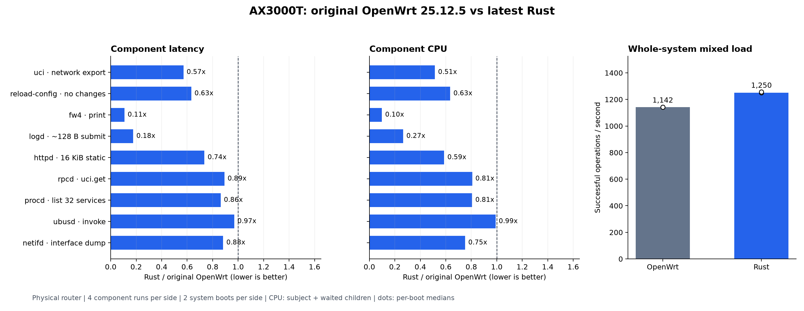

# R86：性能复核、故障修复与最新版部署

开始日期：2026-09-12。起点 `065d905`，部署前运行栈为R84。
状态：最终发布 `f612e30` 已构建并校验九个二进制；HTTPD恢复8KiB读缓冲后的七组功能门全部通过。
36个必要功能门与5个原版压力对照均通过；九组件隔离矩阵已完成。
最新版已安装；原版和Rust各两次冷启动、每次健康确认及五轮整机负载和TLS补测均完成，设备最后保持Rust。

## 范围与验收

复核HTTPD、rpcd、procd、ubusd、netifd五个守护进程及其共享ubus/UCI路径，最终部署完整九组件
发布产物。基线仍是精确OpenWrt 25.12.5镜像，不把“比上一版Rust快”当成“比原版快”。
分别报告均值、CPU、p95/p99、内存和运行间波动；保留全部有效样本。代码检查、回归和故障注入
用于排除已知缺陷，不能据此保证所有代码在所有输入下没有bug。

用户本轮已明确授权最后部署，并取消必须连接lan4网线的旧要求。通过Wi-Fi执行；部署前保留
离线备份、来源和二进制身份核验、自动回退，部署后从客户端确认重启、无线、DHCP、DNS、
IPv4/IPv6和管理服务。没有取消实际failsafe救援的设备行为说明。

## 1. 重新核对R85结论

[R85](R85_OPTIMIZATION_LOG.md)指定最终样本的66项均值与CPU汇总值低于原版，但不是所有指标全面提升。

| 缺口 | 保留的证据 | 下一步 |
|---|---|---|
| rpcd短请求尾延迟 | R44加长session_access c1/c4 p99分别+31.28%/+33.63%；部分单轮方向相反 | 检查调度/收发路径及逐轮离散程度；正式候选固定矩阵复核 |
| ubusd小幅优势及尾部 | U04 invoke c1 CPU仅−0.95%；精确查询c1 p99+6.54%、invoke c4 p95+4.71% | 检查消息循环、组包和队列的实际成本与公平性 |
| HTTPD保持连接内存 | H16在Oracle保持64连接RSS增长3128KiB，原版444KiB | 分开检查读写缓冲、线程和空闲连接保留成本 |
| procd原版日志缺失 | P10原版第2、5轮各缺一条末尾日志；候选五轮全通过 | 保留原始失败，不以重跑或放宽断言替代 |
| 此前整机收益尚未确认 | R84的混合负载CPU/请求+12.43%；R85没有重新部署测量 | 本轮在最新产物上独立测量，不能相加单组件比例 |
| netifd初始化检查缺口 | 本镜像没有proc task/children接口；旧检查把cat读取失败当成空列表 | 保留原数据为诊断，补上PPid检查后重做最终矩阵 |

## 2. 已定位的故障边界

### F01 · rpcd唤醒管道写满会阻塞信号处理

- 原实现只把读端设置为非阻塞；写端仍阻塞。测试先填满真实管道，再恢复生产标志并调用实际
  SIGCHLD处理函数。修复前子进程被卡住，3秒超时后回归测试判失败。
- 两端都设置为非阻塞，且设置失败在启动时明确返回错误。满管道已保持可读，实际信号状态和
  工作结果在原子变量/消息队列中保存，唤醒字节不承担消息内容。
- 同时保护信号处理前的线程errno，避免EAGAIN覆盖被中断系统调用的错误。修复后的相同满管道
  测试通过，并验证排空后可再次唤醒。procd、ubusd和netifd的非阻塞信号写端也补上errno保护。
- netifd启动时原来忽略fcntl失败；改用现有OwnedFd管道帮助函数，非阻塞设置成功后才公布
  描述符，失败自动关闭两端并返回错误。运行期的退出/重载语义没有改变。
- 依据：[Linux pipe语义](https://man7.org/linux/man-pages/man7/pipe.7.html)与
  [self-pipe说明](https://man7.org/linux/man-pages/man2/select.2.html)及
  [信号处理中的errno保护](https://man7.org/linux/man-pages/man7/signal-safety.7.html)。

### F02 · HTTPD线程创建失败会终止服务

- 发布配置为panic=abort，连接路径直接调用std::thread::spawn。独立namespace内只限制
  测试进程的RLIMIT_AS，禁止它再预留一个线程栈；旧正式HTTPD被SIGABRT终止（退出−6）。
  原版对照存活。没有限制构建机或正式路由器的资源。
- 改为Builder::spawn处理创建错误，关闭未接管的连接并归还计数，保留监听；错误日志也使用
  返回错误的写入接口。回归要求故障后继续成功处理超过连接上限数量的请求，并检查fd归还。
- 依据：[Rust线程Builder文档](https://doc.rust-lang.org/std/thread/struct.Builder.html)。
- 相同资源故障复验通过：限制下三次连接均由候选拒绝，进程存活；恢复后四次请求成功，
  连接槽和fd均归还。原版同样存活，三次限制期请求均成功。

### F03 · 测试脚本把不支持的proc读取当成子进程已回收

- 查看本轮netifd采集日志发现`/proc/PID/task/PID/children`读取失败；确认精确镜像未提供该接口，
  `/proc/PID/status`可用。旧shell条件用空字符串判断，没有传播cat失败。
- 在保留真实父子关系、没有children接口的固定文件夹中复现：旧条件返回成功，新检查拒绝。
  改为扫描status的PPid，匹配完整父PID；任何读取失败都不通过。存活子进程和僵尸都必须被回收。
- 回调成功、两秒子进程CPU稳定及全部查询区间子进程CPU为零的检查保留。分析器还要求记录新的
  PPid检查证据，旧数据标记为诊断，不再作为完整初始化门的验收依据。
- 27项工具测试通过，包括仍有子进程、僵尸、不同父PID和读取失败场景。最终netifd追加相同
  二进制、相同14项负载、每侧四轮的完整复测；这项决定在查看首批netifd汇总之前记录。
- [独立门验证](R86_parts/benchmark_gate_validation.json)：原版文件系统内，两侧各运行40次的
  缩短矩阵均通过2/32接口的PPid检查；183个原始文件逐一校验。该短测仅验证门，不用作性能结论。

[netifd补测](R86_parts/netifd-final-gate/results.md)使用相同14项负载和四轮交错顺序，
通过完整PPid/回调/子进程CPU门，112条观测均有效。平均延迟与CPU全部下降：CPU下降7.82%–95.48%。
`interface_named_32`的p95/p99为+12.72%/+6.63%，并发版本为+0.85%/+3.70%；
其余负载的p95/p99均下降。旧N05结果保留为诊断，最终netifd只采用本补测。

[最终HTTPD矩阵](R86_parts/httpd-final2/results.md)的16项平均延迟下降7.60%–42.49%，
CPU下降7.93%–50.00%，p95/p99全部下降。64保持连接的四轮内存检查中，原版RSS增量452 KiB，
候选2096 KiB；匿名RSS增量452→1964 KiB。Oracle同机实验中，优化前后候选RSS增量为
3128→1936 KiB（−38.11%）；该优化比例不套用到路由器数据。最终路由器候选仍高于原版，
每连接线程与读缓冲等成本仍存在，因此没有取得内存全面改善。

至此九组件隔离矩阵全部通过身份和主机门；各组件主负载的平均延迟与CPU均下降，但ubusd一项
平均延迟+0.27%、一项CPU持平，部分负载尾延迟上升（见上文）。这些限制与部署后的整机冷启动、混合负载、TLS和健康观测
一起保留，不能把单组件百分比相加。

## 3. HTTPD响应缓冲的所有权

每个保持连接的线程原来保留自己的16KiB输出窗口。改为请求解析成功后取出一份输出缓冲，
响应完全排空后归还；全服务最多保留八份，每份不超过两个窗口。空闲连接不再持有输出窗口。
只复用已初始化内存，下一响应从空区间开始，发送前必须覆盖字节，不复用响应、路径或鉴权结果。
读缓冲尝试从8KiB减至2KiB，但正式模糊回归出现8KiB过长路径的关闭行为变化，因此恢复8KiB。
没有缩减线程栈，也没有加入异步运行库。

跨连接短响应、空响应和文件响应复用测试通过。构建机41项静态/变化文件/持久连接检查通过。

| Oracle同一64连接检查 | 原版RSS增量 KiB | 候选RSS增量 KiB |
|---|---:|---:|
| 仅故障修复，原缓冲策略 | 444 | 3128 |
| 共享输出缓冲，读缓冲仍8KiB | 444 | 1936 |
| 共享输出缓冲，读缓冲2KiB | 444 | 1756 |

仅保留输出缓冲优化时，相对起点增量下降38.11%；2KiB试验下降43.86%，但该试验不用于部署。
两者仍高于原版；线程、读缓冲和解析存储等仍随连接增长。
这些是构建机RSS采样，尚不是正式发布文件的路由器内存结论。压力下HTTPD仍应存活并可恢复。

## 4. 固定正式验收计划（开始测量前记录）

- 固定GitHub release-image生成的完整九文件身份，CI通过后提取并逐文件校验。
- 五组件原版/正式候选四轮完整矩阵：HTTPD16、rpcd18、procd8、ubusd10、netifd14项。
  rpcd每项50000次，其余10000次；各侧四次新建服务，固定交错顺序；CPU与全部分位数均保留。
- UCI、fw4、reload-config、logd与R85最终文件逐字节相同；仍补齐原版/候选四轮基础性能对照，
  确认整套九组件。一次性程序的CPU单独使用客户端wait收集的子进程计数，不误计为守护进程CPU。
- HTTPD另做双侧四轮64保持连接资源观察；功能门覆盖静态、CGI、TLS、JSON-RPC、SSE、
  畸形请求、整体超时和资源耗尽恢复。信号相关四组件执行完整原有功能门与新增单元回归。
- 部署后原版与最新Rust各两次冷启动，顺序Rust/原版/原版/Rust，各窗口原有五轮整机负载、
  空闲观测和TLS连接测试；最后保持最新Rust。不能将组件百分比相加代替整机结果。
- 新出现的失败和性能回退都保留并调查；前述计划不因结果不理想而删减工作负载或挑选轮次。

## 5. 正式构建及已完成的预试

- 最终修订：`f612e30f2e282fe5b3b3084a2da0edaa6047f612`。
  [CI 34695786971](https://github.com/WenliangCao/owrt-control-plane-rs/actions/runs/34695786971)与
  [release-image 34695787044](https://github.com/WenliangCao/owrt-control-plane-rs/actions/runs/34695787044)
  均成功，见[最终构建身份](R86_parts/final2_canonical_build.json)。九个文件中只有HTTPD相对第一批改变；
  其余八个逐字节相同，沿用各自完整身份匹配的测试。HTTPD重新执行全部功能和性能验收。
- 最终HTTPD的单元、资源故障、静态响应、扩展兼容、R14、133项fuzz及30000次CGI压力门全部通过；
  fuzz保留22项既有差异，没有新增差异。最终九文件部署包通过离线安装、切换、确认、回退和救援检查。
  五个更改组件的Clippy检查已完成，缺失unsafe安全说明检查通过；其他风格警告仍保留在记录中。

- 修复代码：`482ab8f0d0fbb987a0aab12290cf10dd5a41257a`。
- [CI 34694864519](https://github.com/WenliangCao/owrt-control-plane-rs/actions/runs/34694864519)
  与[release-image 34694864310](https://github.com/WenliangCao/owrt-control-plane-rs/actions/runs/34694864310)
  均成功。七个APK、镜像、核心归档和提取出的九个二进制哈希均已校验，
  见[构建身份](R86_parts/final_canonical_build.json)。
- [共享输出缓冲预试](R86_parts/http-pool-pilot/results.md)为读缓冲仍8KiB的实验文件，每侧两轮。
  16项均值及CPU中位数均低于原版；例如16KiB dat c1延迟−26.52%、CPU−40.68%。
  完整64条工作负载观测及分位数保留；预试不替代最终发布文件的四轮验收。
- 本轮三个离线备份归档已完整读取并检查gzip尾部；配置逐文件与当前设备一致。
  OpenWrt 25.12.5原版和小米1.0.47恢复镜像哈希通过。私人归档和原始测量不入Git。

### 第一批HTTPD未通过的边界与处理

完整133项中，`long-path-8k`从R84的413响应变成连接重置。原版同样重置；这项变化没有造成
服务崩溃，也不应说成比原版更差。但本次性能优化不扩大既有畸形请求行为变化，恢复8KiB读缓冲，
保留贡献更大的共享输出缓冲，不修改原fuzz门的133项或22项既有差异断言。第一批文件的完整
性能结果和这项失败保留；仅对实际二进制发生变化的最终组件重做验收。

附加静态检查发现procd两处、HTTPD分析用例四处缺少unsafe安全说明，补上具体前提；这些为
注释修改。第一份计划JSON误抄R84轮次顺序，已保留旧JSON并按未改动的R85采集器更正描述：
原版/候选/候选/原版/原版/候选/候选/原版。采集器和已经执行的次序没有修改。

九组件汇总扩展还修正了分析器遗留的五组件白名单，改为使用已有完整负载表；23项分析和采集工具
测试通过。该修正只允许读取其余四组件，不改变已采集的数据或统计公式。
UCI采集完成后的首次汇总还暴露出常驻PID假设：一次性程序本来没有`subject-sha256.txt`。
分析器现在明确检查组件的进程类型，一次性命令验证可执行文件哈希，守护进程继续额外验证实际
运行进程哈希。UCI原样本重新分析并独立核对子进程CPU，无须重新采集；完整工具回归28项通过。

## 6. 最终文件的功能回归

[验收汇总及证据哈希](R86_parts/validation.json)逐项关联正式二进制与日志；原始归档5722个文件
下载后全部逐文件校验。第一批2KiB读缓冲的失败仍在归档中，最终HTTPD使用重新执行的七组结果。
其余八个二进制与第一批完全相同，复用身份一致的检查。

| 项目 | 结果 |
|---|---|
| HTTPD / rpcd / procd / ubusd / netifd单元测试 | 30 / 53 / 73 / 24 / 155，共335项通过 |
| 网络生命周期与故障完整套件 | 29/29，无跳过 |
| rpcd固定种子差分 | 733步，0差异；忙循环下会话到期、子进程回收与fd归还通过 |
| ubusd畸形消息及上限 | 664项一致；慢客户端、消息大小、队列与fd约束通过 |
| UCI差分 | 193/193一致 |
| procd压力、PID1、TTY及sysupgrade | 必要门通过；本批原版/候选各五轮压力均通过 |
| HTTPD静态、扩展兼容及CGI压力 | 41项静态、31项扩展及断开SSE清理、30000次CGI通过 |
| HTTPD畸形请求 | 133项，22项既有差异，0新增差异，进程全部存活 |
| 资源耗尽恢复和部署回退 | 两侧服务存活并恢复；五项离线安装/切换/回退/救援门通过 |

本批procd原版压力通过不覆盖R85已经记录的两次原版日志缺失。Clippy的unsafe说明门通过：
HTTPD、procd覆盖全部target，其余三个覆盖运行程序；其他风格或死代码警告没有隐藏。
这些是有限输入和场景下的验证，不构成任意输入均无缺陷的证明。

## 7. 最终组件性能（已完成）

下表沿用原有各组件的代表负载；数值为每侧四轮统计值的中位数，负值表示低于原版。
全部74项负载的分位数、逐轮范围和CPU分项在各组件JSON中保留。

| 组件 | 代表负载 | 平均延迟变化 | 被测程序CPU/操作变化 |
|---|---|---:|---:|
| UCI | 导出network | −42.87% | −48.57% |
| reload-config | 配置无变化 | −36.74% | −36.53% |
| fw4 | 生成规则 | −89.19% | −90.11% |
| logd | 约128字节日志发送 | −82.32% | −73.44% |
| HTTPD | 16KiB静态文件，单客户端 | −26.44% | −41.27% |
| rpcd | uci.get network | −10.75% | −19.26% |
| procd | 列出32个服务 | −13.66% | −19.32% |
| ubusd | invoke | −3.04% | −0.95% |
| netifd | interface dump | −11.72% | −24.87% |

[rpcd完整四轮对照](R86_parts/rpcd/results.md)的18项平均延迟及CPU中位数均低于原版；
延迟下降0.53%–47.14%，CPU下降8.70%–56.66%。固定加长样本中仍有少数尾部回退：
`session_access_64`的p95为+9.36%，`uci_configs`的p95为+4.07%；
`session_access_64`的p99为+2.42%。逐轮范围和全部分位数保留在该目录的JSON中。
本次样本不能证明先前尾延迟波动已经彻底消失，也不能把单轮统计抖动归因为某项代码修复。

[procd完整四轮对照](R86_parts/procd/results.md)的八项平均延迟和CPU中位数均下降：
延迟−3.98%至−13.66%，CPU−7.32%至−24.10%。`service_list_32_c4`的p95/p99
分别+1.45%/+1.69%，其余七项p95/p99均低于原版。

[ubusd完整四轮对照](R86_parts/ubusd/results.md)的十项中，九项平均延迟下降；CPU九项下降，
`lookup_c4`持平。`lookup_all_128`平均延迟1461.45→1465.33µs（+0.27%），CPU则下降15.44%；
原版四轮均值范围1434.11–1482.56µs，候选1433.62–1474.69µs，不能据此声称延迟明确改善。
`lookup_c4`两侧CPU计数中位数都是23.5个tick；时间源为100Hz，每轮只有23–25个tick，
这项没有测得CPU收益。`invoke`CPU仅−0.95%，仍属于很小的优势。

ubusd精确`lookup`的p99为110.57→125.84µs（+13.81%）。候选四轮分别114.11、114.34、
141.19、137.34µs，后两轮较高；原版范围109.34–118.49µs。全部有效轮次保留，
不删除较慢样本，也不以延长测量直到出现有利结果来替换这批数据。

[UCI四轮对照](R86_parts/uci/results.md)三项平均延迟下降23.65%–42.87%，CPU下降24.61%–48.57%，
p95/p99也全部下降。24条观测均按原始数据的等待回收子进程CPU独立核对；没有常驻PID或进程RSS结果。

其余三个二进制虽未改变，也完成了每侧四轮对照：

| 组件及负载 | 平均延迟变化 | CPU变化 |
|---|---:|---:|
| [reload-config](R86_parts/reload-config/results.md)，配置无变化 | −36.74% | −36.53% |
| [logd](R86_parts/logd/results.md)，约128字节日志发送 | −82.32% | −73.44% |
| logd，读取100条日志 | −40.59% | −48.10% |
| [fw4](R86_parts/fw4/results.md)，生成规则 | −89.19% | −90.11% |
| fw4，内核规则检查 | −58.76% | −81.59% |

这些负载的p95/p99均下降。日志发送计时包含队列背压，不是逐条日志端到端处理时间。
三个一次性程序的全部48条观测又直接按原始`child_cpu_s / successful`核对，依赖CPU另列。

独立复核逐条重算了全部592条观测（328条串行、264条四客户端并发），核对原始数据、九项身份、
逐轮统计及全部汇总值，未发现统计计算错误。74项负载中，平均延迟73项下降、1项上升；
CPU73项下降、1项持平；p95和p99均为66项下降、8项上升。没有把多次负载轮次当成独立冷启动。

最终报告由[`analyze_r86.py`](../../tools/benchmark/analyze_r86.py)复核并生成：固定八轮顺序、
原版/候选及测量工具身份、九组件592条观测、HTTPD四轮内存、四个启动窗口的原始文件校验和，
以及最后Rust健康和部署完成事件。未完成窗口时实际验证会拒绝输出。
准备清单按原哈希保留，部署完成状态单独记录；配置与部署前备份一致，执行面与规范化防火墙规则
检查的含义为四个窗口彼此一致。报告只包含允许公开的指标与产物哈希。

## 8. 部署后的整机结果

部署编排器通过 Wi-Fi 完成安装、自动回退准备和四个冷启动窗口，顺序为 Rust-1、stock-1、stock-2、Rust-2；
最后一个窗口确认九个组件均为发布哈希，配置和待确认状态均正常。每个窗口连续健康采样超过180秒并追加30秒观察，
每个窗口完成500,650次操作和五轮负载；stock-2与Rust-2还完成相同 AES256-GCM 套件的四项 TLS 补测。
客户端 DHCP、双频 AP、IPv4/IPv6 DNS 与 HTTPS、watchdog 和 loopback/lan/wan/wan6 均通过。

| 指标 | 原版 | Rust | 变化 |
|---|---:|---:|---:|
| 混合负载吞吐（次/秒） | 1,142.08 | 1,250.46 | +9.49% |
| 混合负载控制面 CPU（µs/次） | 785.00 | 707.25 | −9.90% |
| 固定整批控制面 CPU（秒） | 389.32 | 310.32 | −20.29% |

混合负载数字为每侧十轮统计值的中位数；固定整批CPU为每侧两个完整启动窗口的中位数，
每批500,650次正式操作，含六个守护进程自身CPU及一次性命令等待回收的子进程CPU，
不含TLS、预热和空闲采样。

整机真实`service list`仍有回退：平均延迟467.35→472.10µs（+1.02%），
控制面CPU298.00→354.50µs/次（+18.96%）；原版十轮CPU范围297–305，Rust为348–357µs/次。
该CPU口径合计六个守护进程，服务列表来自实际运行系统；隔离测试则是固定32服务夹具、只比较
被测procd CPU，因此两者不能互相替代。这里没有足够证据把整机回退归因于某个改动。
同一真实服务列表在并发混合负载中的平均延迟下降3.40%，其p95/p99下降6.90%/8.62%；
独立查询的p95/p99也下降0.82%/2.24%。这些差异说明结论必须限定到具体负载。

Rust 两次窗口的混合吞吐为 1,249.60–1,255.91 次/秒，原版为 1,141.56–1,142.44 次/秒；
窗口内五轮范围、空闲资源、TLS 分项及所有原始归档哈希见[整机表格](R86_parts/rendered/system_results.md)、
[TLS 表格](R86_parts/rendered/tls_results.md)和[部署证明](R86_parts/deployment.json)。
Rust 空闲前采样的六个控制面进程 RSS 合计为4,796/4,824 KiB，原版为9,420/9,432 KiB；
这是共享页计数，不是PSS或独占物理内存。整机 MemAvailable 中位数反而由原版137,912降至Rust132,050 KiB（−5,862 KiB，−4.25%），
同时Rust文件缓存更高；不能把进程RSS下降解释成可用内存增加。HTTPD保持64连接的最终路由器RSS增量仍为452→2,096 KiB，
该资源代价没有被整机空闲RSS数字掩盖。

默认TLS四项平均延迟下降21.89%–43.16%，HTTPD CPU下降53.64%–86.18%；
相同AES256-GCM套件的补测方向一致。fresh请求统一限速20次/秒，所以吞吐不是握手能力上限；
CPU包括明确计数的预热和SSH采样开销。默认TLS每侧两次启动，相同套件每侧一次启动。

只有两次冷启动/侧，设备继续承载背景网络活动；结果不代表所有配置和负载，也没有测量内核转发吞吐。
已测结果支持整体管理负载收益，但不支持所有指标全面提升或任意输入无bug的保证。

最终设备运行发布提交 `f612e30` 的九个 Rust 二进制，内核仍为6.12.94；离线备份、原R84包和自动回退门均保留。
准备清单保持 `prepared_not_deployed` 状态，完成事实由独立部署证明记录。

完整的逐项回退、持平、资源代价和协议差异（含原版值、Rust 值、百分比及测量口径）见
[R86 所有回退与持平事实清单](R86_REGRESSIONS_COMPLETE.md)。其中依赖进程 CPU、客户端 CPU、
RSS、文件缓存、线程数和温度属于诊断字段，不能直接解释为被测组件自身变慢。
