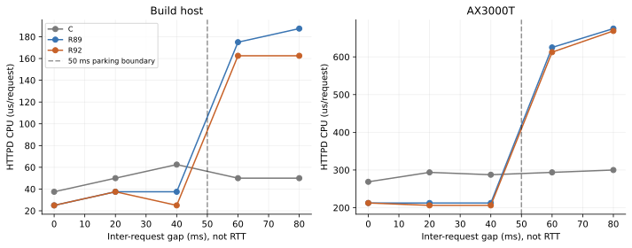
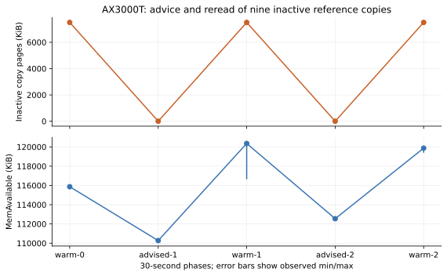
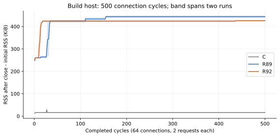

# R92：性能、尾延迟与内存复核

运行时固定 `ca1a912`，比较对象为精确镜像 C 和正式 R89。原始数据留在 private；
本文只引用已核验身份、完成标记及下载哈希的派生结果。完整表格见
[整机](R92_parts/whole_system.md)、[九组件](R92_parts/metrics_summary.json)、
[尾延迟](R92_parts/tail_latency.md)。

## 1. 整机结果与历史增幅

四个新冷启动按 Rust-1→C-1→C-2→Rust-2，各五轮。每窗口 500650 次被测操作，
前后各 120 秒 idle；另有标准 TLS 和第二窗口的共同 cipher 对照。四窗口配置、执行面和
归一化 nft 规则相同，所有操作与客户端健康门通过。

固定整批控制面 CPU 中位数 **389.645→298.495 秒（−23.39%）**；mixed 吞吐
**1144.125→1282.019 op/s（+12.05%）**，mixed CPU/操作 **785.875→674.250 µs（−14.20%）**。
这些是本轮 C/R92 比较，不能用来掩盖相对历史 R89 的增幅：

| 整机项 | 本轮 C CPU µs/op | 历史 R89 | R92 | R92/R89 |
|---|---:|---:|---:|---:|
| network | 623.5 | 412.5 | 409.5 | −0.73% |
| rpcd | 412.0 | 330.5 | 329.0 | −0.45% |
| procd | 300.0 | 262.5 | 261.5 | −0.38% |
| log | 827.5 | 437.5 | 566.5 | **+29.49%** |
| uci | 1900.0 | 1000.0 | 1000.0 | 0.00% |
| fw4 | 198333.3 | 15000.0 | 14666.7 | −2.22% |
| http-static | 429.5 | 355.0 | 354.0 | −0.28% |
| http-jsonrpc | 1435.0 | 1200.0 | 1312.5 | **+9.38%** |
| mixed-total | 785.875 | 646.125 | 674.250 | **+4.35%** |

mixed 吞吐相对历史 R89 为 **−3.73%**。HTTP mean 为 1345.981→1469.299 µs（+9.16%）；
log mean 为 558.901→646.764 µs（+15.72%）。这两项在本轮两个窗口均出现，不能称为单个
异常点或“全面无回退”。所有原始轮次保留，未挑选最快窗口。

客户端与服务端在同一路由器上；mean latency 与整批 wall throughput 的计时边界不同。
十轮统计来自两次 boot，不是十台独立设备。历史 R89 使用同一冻结客户端，配置 hash 与 network
export bytes 相同，但日期、日志内容、进程历史和系统活动不同；见
[历史比较](R92_parts/historical_r89_comparison.json)、[分进程 CPU](R92_parts/whole_process_cpu.json)。

## 2. HTTP 与日志增幅的控制

整机 HTTP 的增幅主要位于 HTTPD 自身：R89 的 610→R92 的 720 µs/op；rpcd 为
358→353.5，ubusd 为 232→240.5。日志 lane 的 logd 为 292→402 µs/op。
各进程中位数之和不必等于逐轮总和的中位数。

固定输入的 logd 三侧四轮却为：

| 负载 | C CPU µs/op | R89 | R92 |
|---|---:|---:|---:|
| syslog 128 bytes | 31.90 | 8.35 | 7.30 |
| log read 100 | 805.50 | 417.00 | 386.50 |

因此没有在固定日志语料中复现整机增幅。整机读取真实最近 100 条日志，R91 恢复默认 netifd
日志通道；历史日志正文未冻结/采回，不能进一步断言增幅全部由日志长度或某一条日志造成。
本次保留修复及该实测差额，不用抑制必要日志来改善分数。

HTTPD 隔离矩阵的 JSON-RPC 是 `uci configs`，整机是 `uci get network`，不能混为一项。
构建机用同一份真实 network bytes 做两方法×两套依赖栈×三 HTTPD×两轮，另有独立追踪：

| 依赖栈 | 方法 | C HTTPD CPU µs/op | R89 | R92 |
|---|---|---:|---:|---:|
| C | configs | 97.5 | 84.0 | 77.5 |
| C | get | 131.0 | 124.0 | 127.0 |
| R92 | configs | 88.5 | 80.0 | 76.0 |
| R92 | get | 131.0 | 120.0 | 118.5 |

R89/R92 的独立追踪同为 ppoll 8599、recvfrom 862、sendto 860、clone 2（两方法共
860 次含预热请求）。构建机未复现路由器窗口增幅，不能用此否定实机观察。
[控制证据](R92_parts/http_bridge_oracle.json)。

路由器最后用四侧交错、每侧四轮控制：C/R89/R92 临时 HTTPD 和当前活动 R92 HTTPD，
共用活动 R92 ubusd/rpcd、同一配置与同一受限 session。复用活动 HTTPD 的参数，临时 listener
改到 loopback 端口；每轮分别验证 configs/get 的完整 JSON，各 10000 请求、30 次预热。
活动 HTTPD 没有重启。共 32 条测量、320000 次被测请求，结果为逐轮中位数：

| 方法 | HTTPD | mean µs | HTTPD CPU µs/op | 三进程总 CPU µs/op |
|---|---|---:|---:|---:|
| configs | C 临时 | 1141.551 | 504.5 | 1006.0 |
| configs | R89 临时 | 956.665 | 388.0 | 858.5 |
| configs | R92 临时 | 963.631 | 393.5 | 861.0 |
| configs | R92 活动 | 1086.913 | 505.0 | 986.5 |
| get network | C 临时 | 1487.939 | 752.0 | 1369.5 |
| get network | R89 临时 | 1370.522 | 632.0 | 1224.5 |
| get network | R92 临时 | 1364.934 | 642.5 | 1231.5 |
| get network | R92 活动 | 1500.879 | 745.0 | 1340.5 |

临时 R92 相对临时 R89 的 HTTPD CPU 为 configs +1.42%、get +1.66%；三进程总 CPU 为
+0.29%、+0.57%。相同 R92 二进制的活动实例比临时实例自身 CPU 高 28.34%、15.95%，
四轮范围不重叠，说明服务实例的运行环境也是必须保留的测量条件。
本控制仍同时改变进程历史、监听端点及是否承接其它活动请求，没有把差额唯一归于分配器、
线程或代码布局；它也不能消去四个整机窗口里的历史增幅。保留现有正确性修复与所有样本，
不靠重启活动 HTTPD 选择更好成绩。[同机完整结果](R92_parts/http_live_pair_router.json)。

## 3. 九组件、四并发与尾延迟

74 种负载×三侧×四轮，共 **888 条测量**。相对同批 C，平均延迟 67 项下降、7 项上升；
组件 CPU 72 项下降、1 项持平、1 项上升；p99 65 项下降、9 项上升。这是逐项中位数的
符号计数，不是显著性检验，也不是把所有微小差值宣布为回退。

| 负载 | mean 相对 C | 组件 CPU 相对 C |
|---|---:|---:|
| ubusd lookup_all_64 | +3.77% | −10.50% |
| ubusd invoke_c4 | +3.40% | 0.00% |
| ubusd lookup_all_128 | +3.23% | −13.52% |
| rpcd session_access_granted_c4 | +7.29% | −14.58% |
| rpcd session_access_64 | +0.08% | −6.67% |
| netifd lan_status | +0.87% | −12.50% |
| netifd interface_named_32 | +0.10% | −8.85% |
| httpd jsonrpc_c4 | −25.26% | **+5.74%** |

JSON-RPC c4 的组件 CPU 为 C 457.837、R89 485.615、R92 484.127 µs/op；R92 相对同机
R89 −0.31%，原有成本仍在。把同轮依赖 CPU 一并计入，总服务端 CPU 中位数则为
C 923.611、R89 880.456、R92 879.960 µs/op。选择保留当前实现：降低整体调用成本和延迟，
并公开 HTTPD 自身较高的成本；不宣称这个 P2/P3 性能边界已经消失。

另做 ubusd/procd 各三侧四轮 CPU 0 affinity，共 216 条测量。代表性的 R92 结果：

| c4 负载 | 双核 p99 µs | CPU 0 p99 µs | 双核四轮 p99 极差 µs | CPU 0 极差 µs |
|---|---:|---:|---:|---:|
| ubusd lookup_all_64 | 4746.56 | 6704.96 | 296.58 | 65.85 |
| ubusd lookup_prefix_64 | 3578.26 | 5630.42 | 116.25 | 169.88 |
| procd service_list_32 | 1819.98 | 2825.28 | 591.58 | 59.93 |
| procd service_list_128 | 4993.73 | 9673.02 | 172.74 | 131.63 |

C/R89 的同类请求也随绑核改变：service_list_32 的 p99，C 为 1766.34→2839.71，
R89 为 1745.05→2842.28 µs。部分轮间范围缩小，部分反而扩大，绝不能说“绑核消除抖动”。
结果支持尾延迟对 CPU 布局和竞争敏感；本控制同时限制服务端、客户端和依赖，无法拆出
IRQ、迁移、唤醒或 run queue 的唯一贡献。选择保留生产双核设置，避免用更差的 p99 换取
较小的轮间范围；完整范围和各侧数据见 [tail_latency.md](R92_parts/tail_latency.md)。

另有六组独立 syscall trace：ubusd 的 `sendmsg` 为 C 238226、R89/R92 各 179399 次；
`epoll_pwait` 分别为 1150/1272/1461 次，`recvmsg` 为 7942/8251/8681 次。
procd 的 R89/R92 同为 `ppoll` 3696、`recvmsg` 7392、`sendmsg` 3792 次，C 则使用
3698 次 `epoll_pwait` 和 7392 次 `sendmsg`。六组均无 `clone`。这些数据区分了事件循环
与发送行为，也表明不能用 HTTPD 的线程重建机制解释这两组件的尾延迟。
trace 的等待时间不是 CPU 时间，受追踪的耗时不进入性能矩阵；调用次数仍不能证明唯一调度根因。
[完整追踪摘要](R92_parts/tail_syscalls_router.json)。

## 4. 停放连接、高延迟与线程重建

构建机 66 组 HTTP 诊断与 60 组 fresh HTTP/TLS netem 诊断独立于性能矩阵。
请求间隔 gap 不是 RTT；netem 只作用于构建机的私有 network namespace。
路由器没有 tc/netem/perf，未安装新内核模块，也未更改 Wi-Fi 管理链路。

50 ms 停放边界在正式 R89/R92 都可达。构建机 400 请求的静态 keepalive 控制中，gap 0
各只有 4 次 clone，gap 80 ms 为 404 次；R92 gap 40→60 ms 的 HTTPD CPU 约
25→162.5 µs/op。这是内存节省与唤醒/线程创建的取舍。

同一 TLS1.2 cipher `ECDHE-ECDSA-AES256-GCM-SHA384`、4 clients、80+8 warmups：
单向延迟 0 ms 时 R92 mean 5.588 ms、CPU 568.18 µs/op，C 为 86.107 ms、2613.64；
100 ms 时 R92 mean 803.461 ms、CPU 1079.55，C 为 1484.377 ms、2670.45。
R89/R92 接近。TLS 的 clone 由 88→264，支持高延迟下每握手三次线程创建；
**fresh 明文 HTTP 在 100 ms 下仍为 88 次 clone**，不能把 TLS 的结论推广到明文连接。
构建机数字只解释机制，不是 AX3000T 的吞吐或延迟成绩。

实机两轮、每组 800 请求的结果如下，CPU 为 HTTPD 自身 µs/request：

| 请求间隔 ms | C | R89 | R92 |
|---|---:|---:|---:|
| 0 | 268.75 | 212.50 | 212.50 |
| 20 | 293.75 | 212.50 | 206.25 |
| 40 | 287.50 | 212.50 | 206.25 |
| 60 | 293.75 | 625.00 | 612.50 |
| 80 | 300.00 | 675.00 | 668.75 |

独立 trace 中，R89/R92 的 gap 0 均为 4 次 clone，gap 80 均为 804 次。
实机确认了跨过停放期限后的 CPU 增幅；R92 没有消除这个取舍。
未把请求间隔实验写成实机 WAN 延迟实验。[实机诊断](R92_parts/http_diagnostics_router.json)。

## 5. 内存保留、文件页与副本缓存

四窗口 idle-before 守护进程 RSS 中位数之和：C **9606 KiB**，R92 **5320 KiB**；
MemAvailable：C **137296 KiB**，R92 **130830 KiB**，差 **6466 KiB（6.31 MiB）**。
这两个指标不能相加或互相抵消。R92 比历史 R89 多做了无线/plugin 观察，会预热解析路径；
历史 RSS 对比不是相同预热流程。

| mincore 口径（每侧两个窗口相同） | C resident KiB | R92 resident KiB |
|---|---:|---:|
| 九个 active 文件 | 532 | 7508 |
| daemon 映射的可打开文件 | 2892 | 5492 |
| 当前 bundle 的九个非运行副本 | 0 | 7508 |
| active/mapped/三份 bundle 按 dev/inode 去重的并集 | 2920 | 15016 |

R92 active 与当前 bundle inode 不重合，mapped 与 active 有重合。C 的 deleted udebug
映射另列、不按旧路径 mincore。页驻留不是 PSS/USS，也不是独占进程内存；不能把表内各行相加。
原来的“MemAvailable 全部差额就是静态二进制”归因过强，本次用独立干预缩小这个边界。

仅对九个非运行副本做两次 `POSIX_FADV_DONTNEED`，每次后重读，五阶段各观察 30 秒。
逐次 mincore 证实副本驻留 **7508→0→7508→0→7508 KiB**；活动 inode 排除，文件 hash、
配置、九身份和客户端健康保持。各阶段中位数：

| 阶段 | 副本驻留 KiB | MemAvailable KiB | MemFree KiB | Cached KiB | daemon RSS KiB |
|---|---:|---:|---:|---:|---:|
| warm-0 | 7508 | 115864 | 108320 | 50484 | 5408 |
| advised-1 | 0 | 110272 | 110240 | 42976 | 5408 |
| warm-1 | 7508 | 120356 | 112816 | 50484 | 5408 |
| advised-2 | 0 | 112544 | 112512 | 42976 | 5408 |
| warm-2 | 7508 | 119872 | 112336 | 50484 | 5408 |

逐出副本页没有增加 MemAvailable；相邻阶段的差值反而为 −5592、−7812 KiB。
Cached 与 Inactive(file) 各减少 7508 KiB，daemon RSS 不变，但 MemFree 没有等量增加，
重读阶段还有其它释放活动。MemAvailable 是内核的可用量估计，其与 MemFree 的同样本差在
预热阶段约 7536–7544 KiB、逐出阶段约 32 KiB；不能把这两者当作同一个物理计数。
控制证明这些副本页可被定向逐出，**不支持“它们解释了全部 6.31 MiB 缺口”**。
当前数据没有分解其余系统活动与内核记账的贡献，保留这个因果边界，未删除回退包或修改全局缓存策略。
[五阶段原始统计的派生摘要](R92_parts/reference_cache_router.json)。

构建机额外做三侧各两轮 **500×64 连接×2 请求**。R92 RSS 从 856→1284、852→1276 KiB；
后 250 轮变化 0、4 KiB，每轮关闭后 fd/线程回初值。R89 末值 1296/1300 KiB，C 为
1056/1028 KiB，后半程也稳定。支持该场景下分配器/路径预热后的有限保留平台，不能证明所有
长期场景无泄漏，也没有只凭 RSS 曲线反推出具体 allocator 的独占页。

实机三侧各两轮 40×64 连接也全部关闭成功，fd/线程每轮回初值：

| 侧 | 两轮初始 RSS KiB | 两轮末值 RSS KiB | 后 20 轮净变化 KiB |
|---|---|---|---|
| C | 1028 / 1020 | 1044 / 1036 | 0 / 0 |
| R89 | 848 / 852 | 1272 / 1280 | 124 / 156 |
| R92 | 852 / 848 | 1296 / 1296 | 4 / 0 |

R89 的短序列后半仍有台阶增长，因此没有把 40 次实验概括成“三侧均已稳定”；其更长的
500 次控制才显示后半平台。R92 的额外保留与低初始 RSS、较低保持连接峰值一起公开，
不把关闭连接误写成立刻归还所有 RSS。

## 6. 处置

本轮保留 50 ms 停放、当前 c4 调度和静态构建；没有为未经唯一归因的尾延迟修改生产调度，
也没有为了缩小历史差额删日志、删旧栈或 drop 全局 caches。性能门保证请求成功、身份一致、
初始化完成、资源计数有效和原始样本完整；它不等同于所有指标都必须快于 R89/C。

运行时正确性、恢复边界及兼容修复照常接受；上述数值增幅和仍有限定的因果解释作为明确保留项。
未来若把低 WAN 延迟、极端长期负载或 CPU 自身成本设为新的硬指标，需要针对该指标另设实测门，
而不是沿用这轮数字作无条件承诺。
